<div align="center">

<picture>
  <source media="(prefers-color-scheme: dark)" srcset="apps/web/public/brand/lockup-dark.svg">
  
</picture>

### Build, run and continuously improve AI voice agents.

Callwright is a platform for voice agents that take phone and web calls. You choose the speech recognition, model and voice, and Callwright runs the call, times every turn and prices every second. Then it tests, scores and fixes the agent from the calls it actually handled.

[](https://github.com/bhaweshverma50/callwright/actions/workflows/ci.yml)

[Hosted demo](https://callwright-one.vercel.app) ·
[Docs](docs/OPERATIONS.md) ·
[Architecture](research/architecture.md) ·
[Specs](specs/)

<br>

<a href="apps/web/public/media/tour.mp4">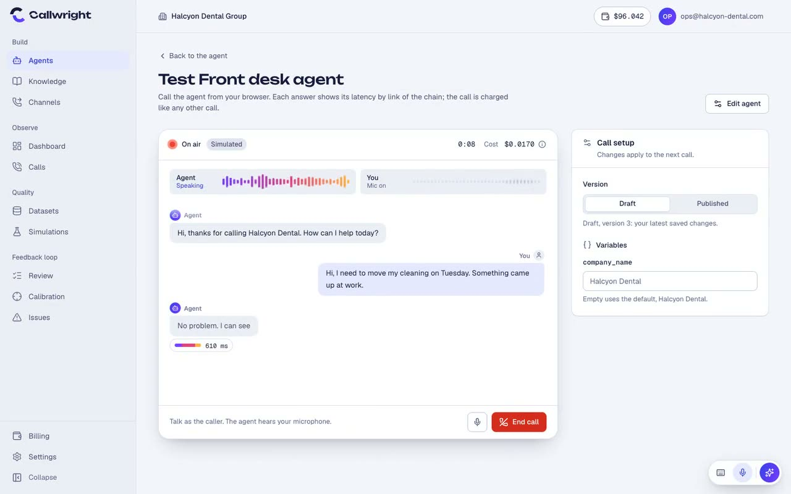</a>

</div>

<br>

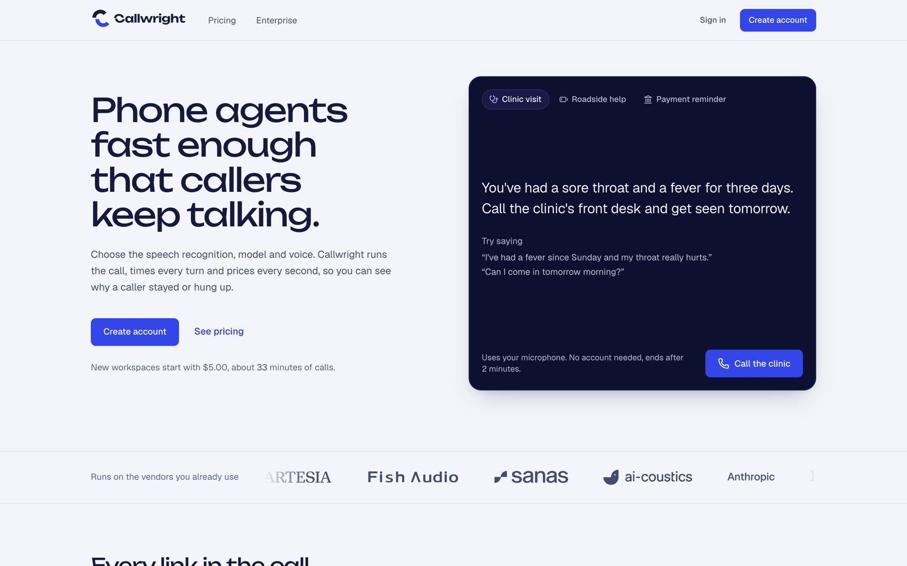

## What you can do

### Build

| | |
|---|---|
| **Agents and templates.** Write a single-prompt agent or start from a template. Pick speech recognition, model and voice, and see the cost per minute update as you change them. Every save is a version you can compare, publish and roll back. | 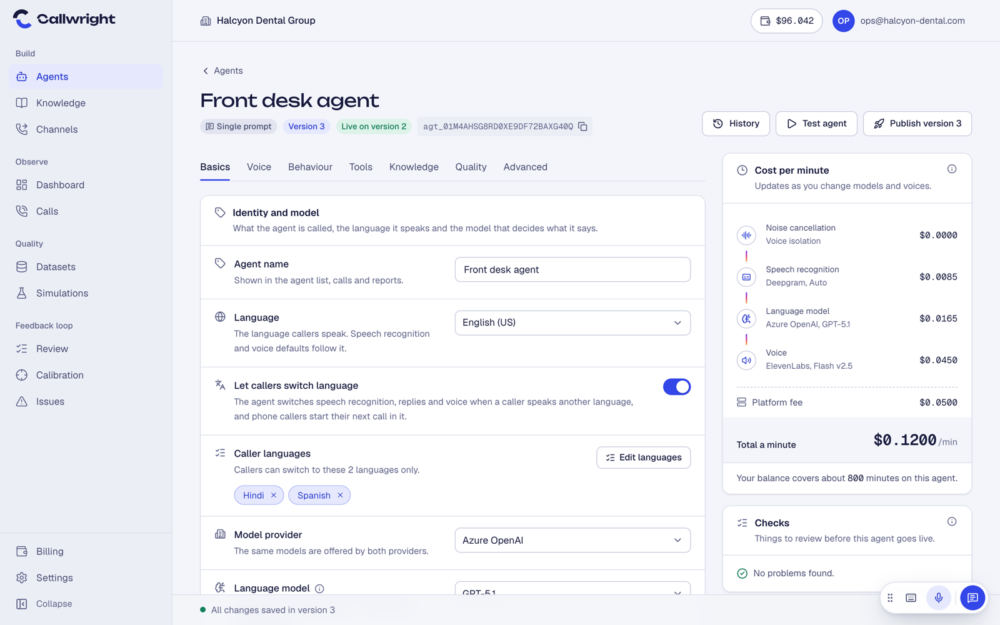 |
| **Flow agents.** Lay out a conversation as steps and transitions on a canvas, with an assistant that edits the flow from a plain-language request. Test it from the same screen. | 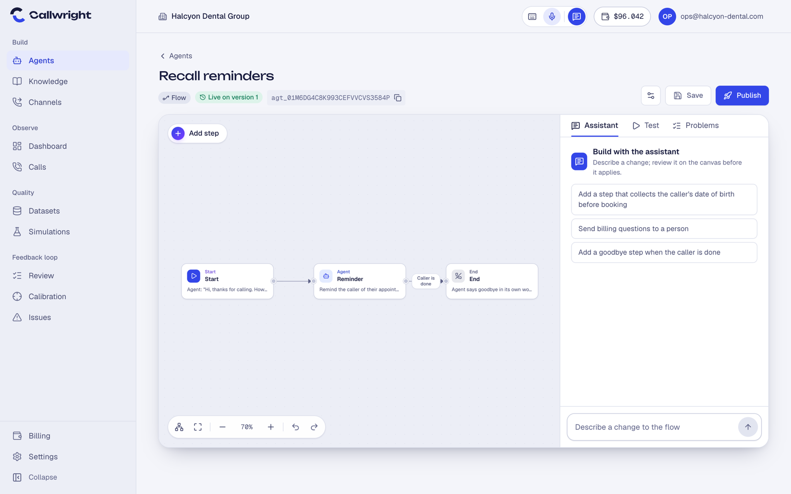 |

Also in this area: tools the agent can call (HTTP requests, transfers, keypad input, callbacks), knowledge bases with document upload and search, a guided setup tour, and callers switching language mid-call (the choice is remembered for their number).

### Run

| | |
|---|---|
| **Voice runtime.** Calls run on LiveKit with a worker that chains VAD, speech to text, an LLM with tools and knowledge search, and text to speech. Test from the browser or take real calls over SIP, phone numbers and WhatsApp. Providers include Deepgram, AssemblyAI, Sarvam, OpenAI, Azure OpenAI, Anthropic, ElevenLabs, Cartesia and Fish Audio, with optional noise cancellation. | 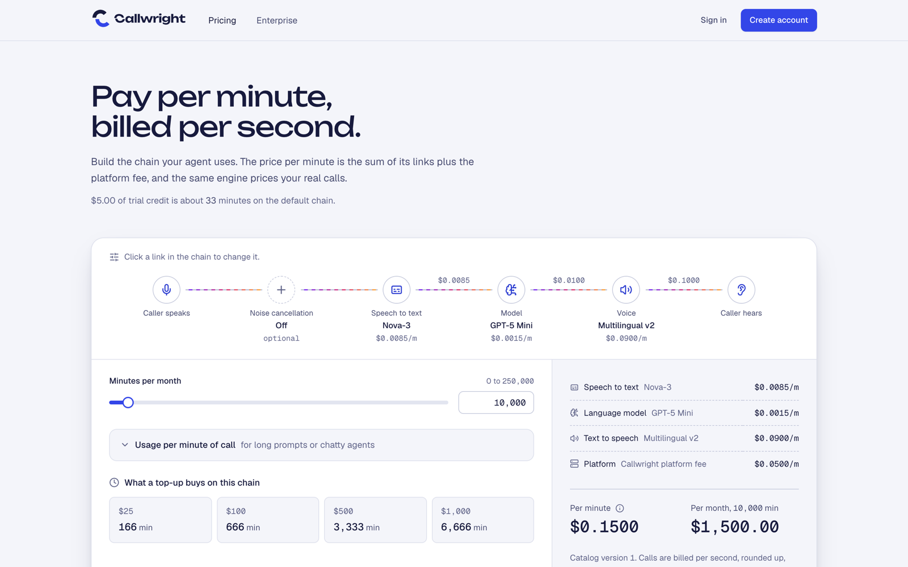 |
| **Calls and analytics.** Every call keeps its transcript, recording, per-turn latency (speech, model, voice) and itemised cost. The dashboard rolls calls, talk time, cost and latency up per agent. | 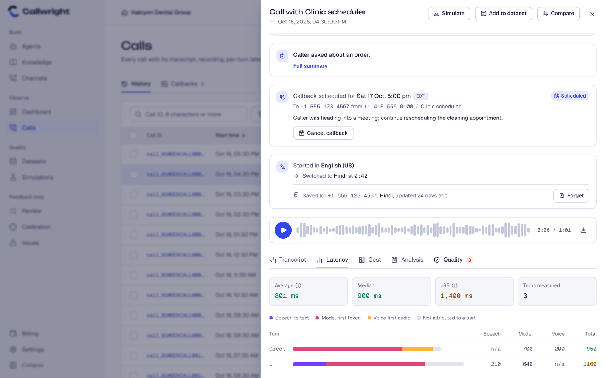 |

Also in this area: scheduled callbacks, outbound calls with calling-hours and do-not-call checks, and signed webhooks for call events.

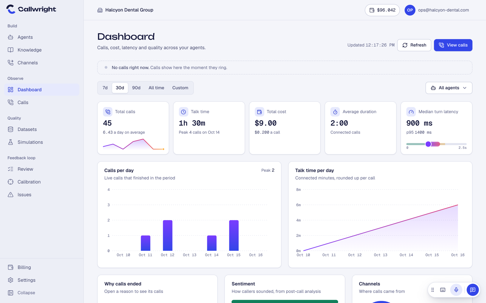

### Improve

| | |
|---|---|
| **Quality and calibration.** Checks score calls (flow completion, intent fulfilment, long silences, tool correctness and more). Calibration compares each check with the labels people gave the same calls, so you know which checks to trust. | 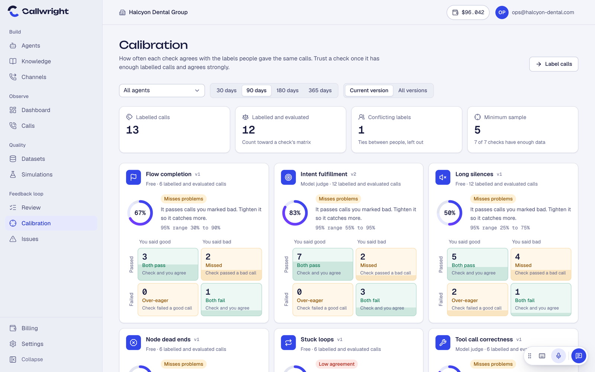 |
| **Testing and simulation.** Replay real callers or simulated personas against a version of an agent, as batches or single runs, and compare every check before and after. | 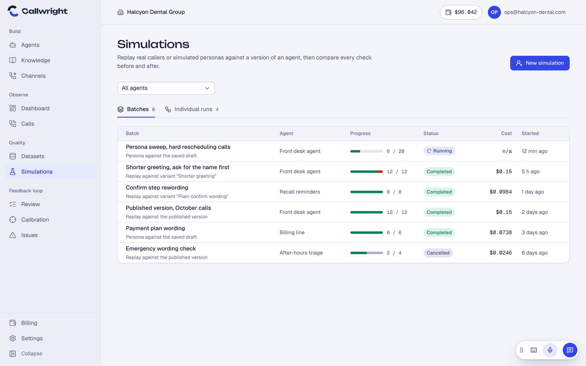 |
| **Issues and auto-fix.** Repeated failures are grouped into issues. Each gets a drafted fix (a prompt rule, a node edit, a tool description) that is validated in simulation before you apply it. | 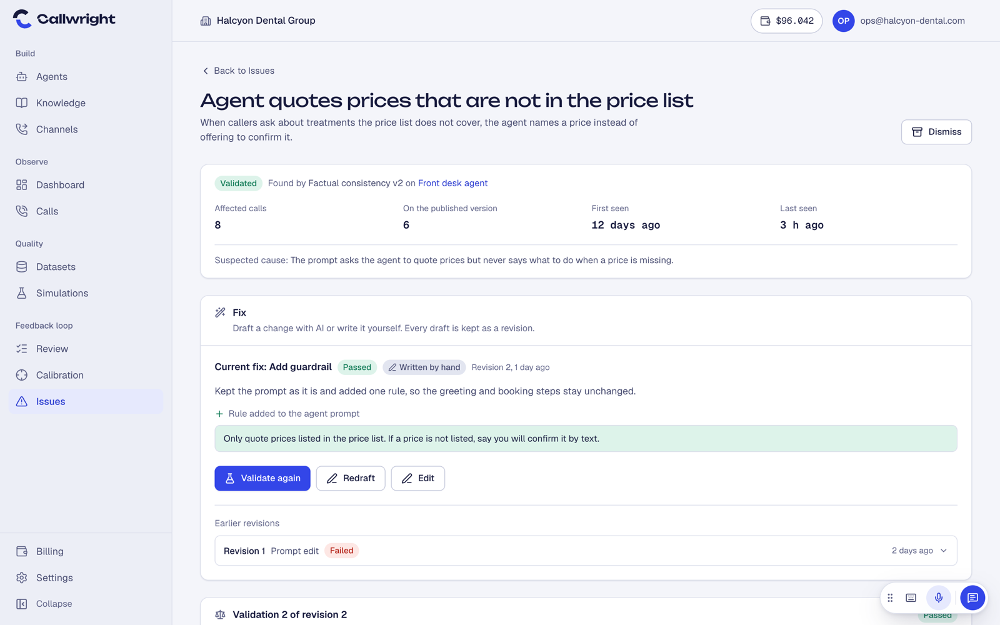 |

Also in this area: human review queues and post-call analysis variables.

## How it works

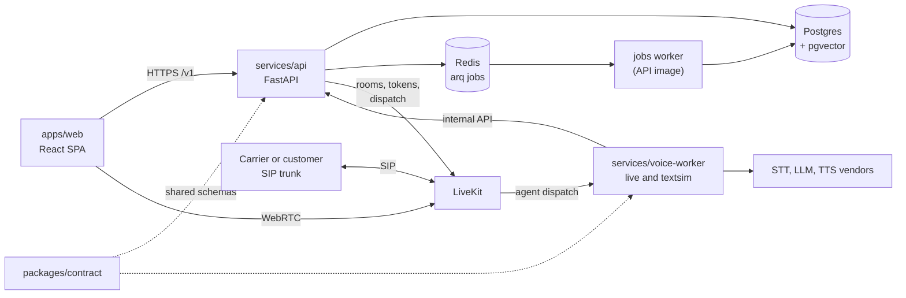

- The **API** serves REST and webhooks, scopes every database session to a workspace with row-level security, and hands out LiveKit room tokens.
- The **voice worker** is one image with two roles: `live` joins calls, `textsim` runs the same pipeline in text mode for tests and simulations.
- The **jobs worker** (same image as the API) runs post-call work and scheduled jobs through arq on Redis.
- `packages/contract` holds the schemas shared by the API and the worker.

The hosted demo runs the API on Cloud Run, Redis, LiveKit and the workers on one VM, Postgres on Supabase and the web app on Vercel. See [`deploy/cloudrun/README.md`](deploy/cloudrun/README.md) and [`deploy/vm/README.md`](deploy/vm/README.md).

## Roadmap

Specified under [`specs/`](specs/) and not built yet: reliable operations (014), provider failover (015), safe tool actions (016), call guardrails and PII protection (017), release safety (018), the quality loop (019), live supervision (020), outcome analytics (021), knowledge connectors (022) and team roles (023).

## Tech stack

| Area | Technology |
|---|---|
| API | Python 3.12, FastAPI, SQLAlchemy 2 (async), Alembic, Pydantic 2 |
| Data | Postgres 16 with pgvector and row-level security, Redis, arq for jobs |
| Realtime voice | LiveKit server and Agents, Silero VAD, turn detection |
| Vendors | Deepgram, AssemblyAI, Sarvam (speech); OpenAI, Azure OpenAI, Anthropic (models); ElevenLabs, Cartesia, Fish Audio (voice); ai-coustics (noise cancellation) |
| Web | React 19, Vite, TypeScript, TanStack Query, Tailwind CSS 4, Radix UI, React Flow (`@xyflow/react`) |
| Tests | pytest, Vitest, Playwright, ruff, mypy, ESLint |
| Tooling | uv (Python), pnpm (web), GitHub Actions, spec-kit |
| Hosting | Cloud Run, a GCE VM for LiveKit and workers, Supabase, Vercel |

## Quickstart

Prerequisites: Docker, [uv](https://docs.astral.sh/uv/) and Python 3.12. No vendor accounts are needed: the API defaults to an offline identity provider and a fake Stripe.

```bash
cp .env.example .env          # optional; every value has a working default
make up                       # Postgres 16 + pgvector on :55432, Redis on :56379
make migrate                  # Alembic migrations, then the agent templates
make api                      # API on http://localhost:8100 (docs at /v1/docs)
make worker                   # arq jobs worker (nightly ledger reconciliation)
make test                     # pytest: unit, contract and integration (needs `make up`)
make lint typecheck           # ruff and mypy
make contracts                # rebuild contracts/openapi.yaml from specs/*/contracts
```

Web app (Node and pnpm):

```bash
cd apps/web
pnpm install
pnpm dev:mock                 # in-browser mock API, no backend needed
pnpm dev                      # against the local API on :8100
pnpm test                     # Vitest
pnpm lint && pnpm typecheck
```

`pnpm dev:mock` serves on http://localhost:5180 (`--port` to change it; the demo account is in `apps/web/src/mocks/demoAccount.ts`). Add `?seed` to a URL to fill the mock workspace with sample calls.

Voice worker (needs LiveKit; see [`docs/OPERATIONS.md`](docs/OPERATIONS.md) for the telephony lab and test calls):

```bash
cd services/voice-worker
uv sync
uv run pytest -q tests/unit   # unit tests; tests/harness runs scripted-caller scenarios
```

Dev sign-up without email: `POST /v1/auth/register`, then read the verification link from the API log or `GET /v1/dev/mail` and send its `token_hash` to `POST /v1/auth/verify-email`. The new workspace starts with $5.00 of trial credit. Top-ups in fake mode open `/v1/dev/fake-checkout/{id}`, whose Pay button sends a signed webhook through the real handler.

| Service | Port |
|---|---|
| Postgres (pgvector) | 55432 |
| Redis | 56379 |
| API | 8100 |
| Web dev server | 5180 |
| Voice worker health | 8190 |

Other commands: `make db-reset` (drop and re-migrate the dev schema), `uv run --directory services/api python -m app.billing.jobs reconcile --now` (ledger check), `uv run --directory services/api python -m app.dev.seed_usage --workspace ws_...` (demo usage).

## Repository layout

```
apps/web/              React SPA (routes by area, design-system components, mock API)
services/api/          FastAPI app, Alembic migrations, arq jobs worker
services/voice-worker/ LiveKit agent worker (live) and text simulation runner (textsim)
packages/contract/     Schemas shared by the API and the worker
specs/                 Spec-kit features 001 to 023 (spec, plan, data model, contracts, tasks)
research/              Architecture conventions and reference-product research
deploy/                Cloud Run and VM deployment (cloudrun/, vm/)
docs/                  Operations reference, design notes, brand assets
contracts/             Assembled OpenAPI contract
```

## Development workflow

Features follow spec-kit: `/speckit-specify`, `/speckit-clarify`, `/speckit-plan`, `/speckit-tasks`, `/speckit-implement`. Each plan is checked against the principles in [`.specify/memory/constitution.md`](.specify/memory/constitution.md) and the conventions in [`research/architecture.md`](research/architecture.md). CI (`.github/workflows/`) runs the contract checks, API tests, web lint, typecheck and tests, and the voice-worker unit and harness suites.

- [`docs/OPERATIONS.md`](docs/OPERATIONS.md): hosting, deploys, telephony lab, playground, test checkout
- [`STATUS.md`](STATUS.md): current state and resume point
- [`BUILD.md`](BUILD.md): build waves and conventions
- [`research/architecture.md`](research/architecture.md): runtime topology and binding conventions
