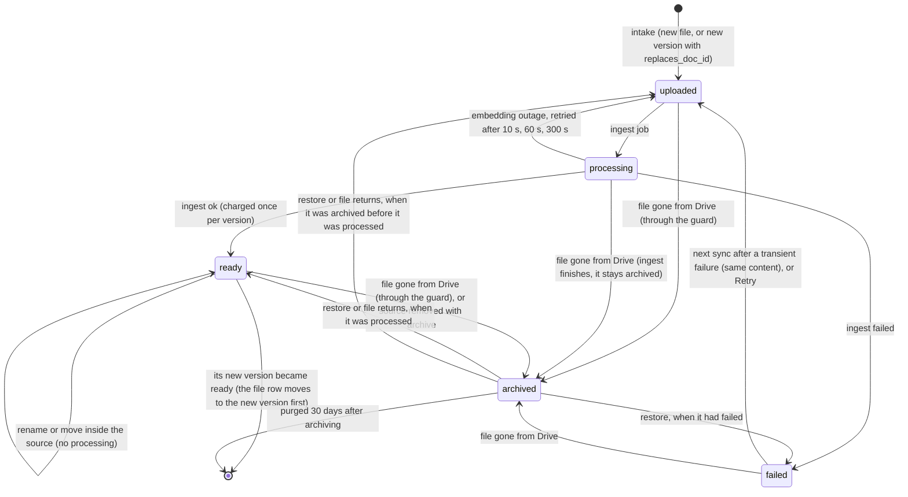
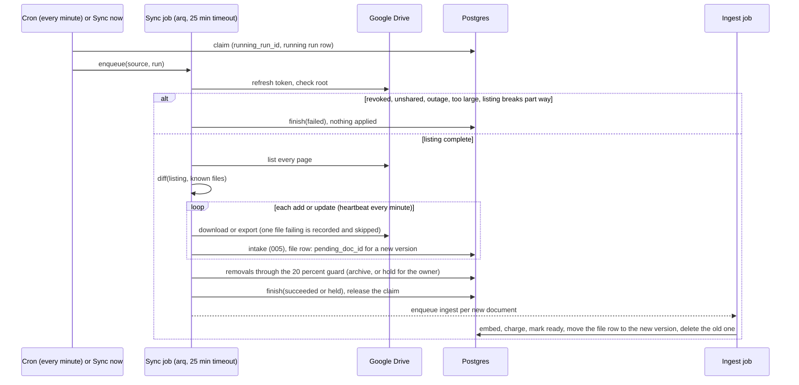

# Feature Specification: Google Drive knowledge sync (022)

**Feature Branch**: `knowledge-connectors`
**Created**: 2026-11-05
**Updated**: 2026-11-12 (scope narrowed to Google Drive sync and a minimal Connections page)
**Status**: Draft
**Input**: Keep knowledge bases in step with the documents a business already keeps in Google
Drive. Connect a Google account once on a minimal Connections page, add a Drive folder or shared
drive as a source on a knowledge base, import Google Docs, PDF and DOCX, then follow changes every
15 minutes and on "Sync now". Re-process only changed files, never delete on lost access, never
archive a large share at once, keep a run history, and never reach Drive during calls. Each agent
keeps searching only the knowledge bases attached to it.

## Why

Today a knowledge base holds only files someone uploads: PDF and DOCX up to 20 MB, deduplicated by
content, processed in the background (005). When a policy, price list or FAQ changes in the
business's Google Drive, someone has to notice, download it and use Replace. Knowledge bases drift
out of date without anyone seeing it, and agents give callers stale answers.

Businesses with several agents keep separate documents for each use case: a clinic's front desk
needs clinic policies, a property agent needs listings. Today that separation comes from attaching
knowledge bases to agents (005). Synced knowledge must keep it: a document synced for one agent's
knowledge base must never reach an agent that does not have that knowledge base attached.

## Scope of this version

In scope: one connection kind (Google sign-in with read-only Drive access and Google Sheets access), Drive folders and
shared drives as knowledge sources, scheduled and manual sync, archive and restore, the mass-archive
guard, safe handling of lost access, and sync history.

Deferred to later specs (were in the earlier draft of 022):

- MCP tools approved one by one (earlier User Story 3).
- Document summary cards (earlier User Story 4).
- API-key, bearer-token and service-account connections, connection circuit breakers, and moving
  HTTP tool secrets onto connections.

## How it works

Drafted from the PR #1 review and checked against the code. The invariants these diagrams must keep
are in [data-model.md](data-model.md#invariants), each with its test.

### Source lifecycle

```mermaid
stateDiagram-v2
  [*] --> pending: source added (first sync claimed in the request)
  pending --> syncing: first sync starts
  healthy --> syncing: schedule (every 15 min by default) or Sync now
  syncing --> healthy: run succeeded
  syncing --> healthy: run failed for a temporary reason (had synced before); retried next schedule
  syncing --> pending: run failed for a temporary reason (never synced); retried next schedule
  syncing --> needs_attention: access_lost, source_too_large, kb_full, or mass_archive (held)
  healthy --> needs_attention: no_credit (scheduled syncs pause, rechecked hourly)
  needs_attention --> syncing: Reconnect, credit added, room made, or next schedule
  needs_attention --> healthy: owner confirms or cancels the held archive
  healthy --> [*]: source removed (keep documents as uploads, or archive them)
  needs_attention --> [*]: source removed
```

A source is never removed while a sync holds it (409 `sync_running`). A sync holds a source through
`running_run_id`; it refreshes `running_since` every minute, a claim silent for 10 minutes is stale,
and only the run that holds the claim may release it or change the source's state.

### Synced document lifecycle

A new version of a file is a separate document that replaces the old one (005 Replace), not a
status of the old one.

The two questions the review asked:

- Any document can be archived. Restore returns it to what it really is: `ready` only when it was
  processed into passages, `failed` when processing failed, otherwise `uploaded`, and processing
  starts.
- When a new version fails, its Drive file shows `processing_failed`, the old version keeps
  answering, and after a transient failure (embedding outage, internal error) the next sync
  processes it again. Content failures (unreadable, no text) wait until the file is edited.

### One sync run

A timed-out or cancelled run is finished as failed and releases the claim; what it applied stays
and the next sync carries on. Three temporary Google failures in a row, or revoked access, end a
run part way; removals run last, so they never happen in a run that ended early.

## User Scenarios & Testing *(mandatory)*

### User Story 1 - Connect a Google account (Priority: P1)

The workspace owner opens a new **Connections** page and chooses "Connect Google". They sign in
with Google and grant read-only access to Drive and access to Google Sheets. Drive access is what
this version uses; Sheets access is requested now so the Google Sheets tool that follows (agents
checking and booking against a live sheet) works without everyone reconnecting. The page then
lists the connection with the Google account it acts as, the access granted, its health and when
it was last used successfully.
The owner can test the connection, reconnect it if access is lost, and remove it when nothing uses
it.

**Why this priority**: No Drive source can exist without a connection, and an expired or revoked
connection is the most common silent failure of any sync.

**Independent Test**: Connect a Google account, confirm the page shows the account's email address,
"Drive (read-only)", "Sheets" and "healthy". Revoke the app's access from the Google account settings, run
Test, and confirm the connection shows "revoked" with a Reconnect action.

**Acceptance Scenarios**:

1. **Given** the Connections page with no connections, **When** the owner completes Google
   sign-in and grants access, **Then** a connection appears showing the Google account's email
   address, "Drive (read-only)", "Sheets" and "healthy".
2. **Given** the owner cancels or declines Google's consent screen, **When** they return to the
   page, **Then** no connection is created and the page says access was not granted.
3. **Given** the owner grants Sheets access but unticks Drive access on Google's consent screen,
   **When** they return, **Then** no connection is created and the page says Drive access is
   required for knowledge sync.
4. **Given** the owner grants Drive access but unticks Sheets access, **When** they return,
   **Then** the connection is created and works for knowledge sync, and shows "Sheets access not
   granted" with a Reconnect action to add it.
5. **Given** a healthy connection, **When** the owner runs Test, **Then** the platform checks
   Drive access and shows the result and the time of the check.
6. **Given** a connection whose access was revoked in Google, **When** it is next used or tested,
   **Then** it shows "revoked", every source using it shows "needs attention: access lost", and
   no synced document is removed.
7. **Given** a revoked connection, **When** the owner chooses Reconnect and signs in with the same
   Google account, **Then** the connection becomes healthy again and its sources resume on their
   next sync, with no source needing to be set up again.
8. **Given** a connection used by two knowledge sources, **When** the owner opens it, **Then** both
   sources are listed with their knowledge bases, and Remove is refused while they exist.
9. **Given** any connection, **When** its details are read back by anyone, **Then** no token or
   secret is ever shown.

---

### User Story 2 - Sync a knowledge base from a Drive folder (Priority: P1)

An operator opens a knowledge base and chooses "Add Google Drive source". They pick a connection,
then a folder (with or without its subfolders) or a shared drive. The first sync imports every
supported file: Google Docs, PDF and DOCX within the 20 MB limit. Each imported document shows
"from Google Drive" with a link to the original. Agents that have this knowledge base attached can
answer from it as soon as the documents are ready. Agents that do not have it attached never see
them.

**Why this priority**: This is the feature. An operator can stop uploading files by hand.

**Independent Test**: Connect a folder holding 10 supported files and 2 unsupported files. Confirm
10 documents become ready with a link to each original, the 2 others are listed as skipped with
the reason, an agent with the knowledge base attached answers a question from one of the Google
Docs, and an agent without it attached does not.

**Acceptance Scenarios**:

1. **Given** a folder with Google Docs, PDFs and DOCX files under 20 MB, **When** the source is
   added, **Then** all of them are imported and become searchable, each marked "from Google Drive"
   with a link to the original.
2. **Given** the folder also holds a Google Sheet, an image and a 30 MB PDF, **When** the first
   sync runs, **Then** those files are listed as skipped with the reason (unsupported type, over
   20 MB), and the rest of the import is unaffected.
3. **Given** a source set to include subfolders, **When** the first sync runs, **Then** files in
   subfolders at any depth are imported; **Given** subfolders are excluded, **Then** only files
   directly in the folder are imported.
4. **Given** a knowledge base with a Drive source attached to the "Clinic front desk" agent only,
   **When** a call to the "Property enquiries" agent searches its knowledge, **Then** no document
   from that source is returned.
5. **Given** a synced document, **When** the operator opens it, **Then** it cannot be edited or
   replaced by upload while its source is connected, and the page says it is managed by Google
   Drive.
6. **Given** a knowledge base with both uploaded and synced documents, **When** a call searches
   it, **Then** both kinds are searched the same way.
7. **Given** the same file reachable through two sources of one knowledge base, **When** they
   sync, **Then** the knowledge base holds one document for it (005 deduplication).

---

### User Story 3 - Stay in step with Drive (Priority: P1)

After the first sync, the platform checks the source's changes every 15 minutes by default and
whenever the operator presses "Sync now". Only files whose content changed are processed again. A
renamed or moved file keeps its document and just updates its name. A file removed from the folder
is archived: it leaves search but can be restored for 30 days. While an edited file is being
processed, the previous version keeps answering callers.

**Why this priority**: Without it the sync is a one-off import, and knowledge drifts again.

**Independent Test**: After the first sync of a 10-file folder, edit one file, rename one, delete
one and add one. Press Sync now and confirm the run shows 1 updated, 1 renamed with no
re-processing, 1 archived, 1 added and 7 unchanged, and that search reflects all four changes.

**Acceptance Scenarios**:

1. **Given** a synced file whose content did not change but whose name or folder did, **When** a
   sync runs, **Then** it is not processed again and its name and location are updated.
2. **Given** a synced file that was edited, **When** a sync runs, **Then** the previous version
   keeps serving search until the new version is ready, as with Replace (005).
3. **Given** an edited file whose new version fails processing, **When** the sync finishes,
   **Then** the previous version keeps serving search and the run lists the file as failed with
   the reason.
4. **Given** a file removed from the folder or moved out of it, **When** a sync runs, **Then** its
   document is archived, leaves search, and shows a Restore action for 30 days.
5. **Given** an archived document within 30 days, **When** the operator restores it, **Then** it
   returns to search without being processed again; **Given** the file is still missing from
   Drive at the next sync, **Then** it is not archived again by that sync, and stays until its
   file returns, the operator archives it with the Archive action, or the source is removed.
6. **Given** an archived document older than 30 days, **When** the clean-up runs, **Then** it is
   deleted permanently.
7. **Given** the operator presses Sync now while a sync of that source is running, **When** the
   press lands, **Then** no second sync starts and the page shows the running one.
8. **Given** the operator changes the schedule, **When** they save a value between 5 minutes and
   24 hours, **Then** syncs follow the new schedule.

---

### User Story 4 - Never lose knowledge to a bad sync (Priority: P1)

Two kinds of event could empty a knowledge base by accident: losing access, and someone moving or
deleting many files at once. In both cases the platform keeps every document serving callers and
asks the operator what to do.

**Why this priority**: A wrongly emptied knowledge base silently breaks every call that relies on
it. This guard is what makes automatic sync safe to turn on.

**Independent Test**: Sync a 100-file folder. Move 25 files out of it and run Sync now: confirm
nothing is archived and the source asks for confirmation. Then revoke the connection and run Sync
now: confirm nothing changes and the source shows "access lost".

**Acceptance Scenarios**:

1. **Given** a sync would archive 25 of 100 documents, **When** it runs, **Then** it archives
   none of them, applies the other changes, marks the source "needs attention" with "This sync
   would archive 25 of 100 documents", and waits for the operator to confirm or cancel.
2. **Given** the operator confirms the held-back archiving, **When** they confirm, **Then** those
   documents are archived and restorable for 30 days; **Given** they cancel, **Then** the
   documents stay in search and the next sync checks them again.
3. **Given** a source with 8 documents, **When** a sync would archive 2 of them, **Then** it
   archives them without asking (up to 2 are always allowed).
4. **Given** the connection lost access or the folder was deleted or unshared, **When** a sync
   runs, **Then** no document is archived, updated or deleted, existing documents keep serving
   search, and the source shows "needs attention: access lost" with a Reconnect action.
5. **Given** Google is unreachable or rate limiting during a sync, **When** the sync fails,
   **Then** nothing is archived, the run is recorded as failed with the reason, and the next
   scheduled sync tries again.
6. **Given** Drive is unreachable, **When** a call searches a knowledge base with a Drive source,
   **Then** the search answers from the synced copy and the call is unaffected.

---

### User Story 5 - See what each sync did (Priority: P2)

Each source keeps a history of its syncs. The operator can see when each one ran, what started it,
what it changed, and which files failed or were skipped and why.

**Why this priority**: The sync works without it, but operators need it to trust the sync and to
fix files that did not make it in.

**Independent Test**: After the change scenario in User Story 3, open the source's history and
confirm the latest run shows trigger "manual", the five counts and no errors, and the first run
shows trigger "first" with the skipped files and their reasons.

**Acceptance Scenarios**:

1. **Given** any source, **When** the operator opens its history, **Then** each run shows start
   and end time, trigger (first, scheduled, manual, reconnect), counts of added, updated,
   unchanged, renamed, archived, held back, skipped and failed files, and per-file errors.
2. **Given** a source, **When** the operator views it, **Then** it shows its state (syncing,
   healthy, needs attention), the time of the last successful sync and when the next one is due.
3. **Given** runs older than 90 days, **When** the clean-up runs, **Then** they are removed from
   the history.

### Edge Cases

- A file shared into the folder from outside the organisation: imported like any other file if
  the connection can read it.
- A file moved between two folders that are both sources of the same knowledge base: treated as a
  move, not a delete and an add. Whichever source syncs first, the document keeps serving search
  and ends up linked to the source that now holds the file, without being processed again.
- The same file in two knowledge bases through two sources: processed once for each knowledge
  base. Each knowledge base deduplicates within itself (005).
- A Google Doc that cannot be read as text, a scanned PDF with no text, or a file over 20 MB:
  skipped or failed with the 005 reason, and listed in the run.
- A Google shortcut pointing at a file outside the folder: skipped, listed as "shortcut".
- A folder with more supported files than the knowledge base has room for (005 limits): files are
  imported up to the limit, the rest are skipped with "knowledge base full", and the source shows
  "needs attention" until room is made.
- A synced file with exactly the same content as another document already in the knowledge base:
  not imported twice (005 deduplication), and listed as "duplicate of" that document.
- A sync running when the next scheduled one is due: the next one is skipped, never run twice at
  once.
- Removing a source: the operator chooses to keep its documents as ordinary uploads or archive
  them. Kept documents become editable uploads.
- Deleting a knowledge base that has sources: its sources are removed with it. Their connection
  stays.
- Removing a connection: refused while any source uses it, and the sources are listed.
- Reconnecting with a different Google account than the connection's: refused with "This
  connection belongs to a\*\*\*@example.com. Sign in with that account, or add a new connection."
  The connection and its sources are unchanged.
- The operator's workspace runs out of credit: scheduled syncs pause and the source shows why.
  Search keeps working from the synced copy.
- Simulations and test calls (008): search the synced copy, exactly like live calls.

## Requirements *(mandatory)*

### Functional Requirements

**Connections**

- **FR-001**: The workspace MUST have a Connections page. In this version the only connection kind
  is Google sign-in, requesting read-only access to Drive and access to Google Sheets. Drive access
  MUST be granted for a connection to be created; Sheets access is optional and its absence MUST be
  shown on the connection with a way to add it by reconnecting.
- **FR-002**: Each connection MUST show the Google account it acts as, the access granted, its
  health (healthy, failing, revoked), the time of its last successful use, and the knowledge
  sources that use it.
- **FR-003**: Each connection MUST have a Test action, and its health MUST be updated from tests
  and from real use by syncs.
- **FR-004**: Connection tokens MUST be stored encrypted and MUST never be shown, logged, placed in
  agent context, transcripts or version snapshots (005 FR-026).
- **FR-005**: A revoked or failing connection MUST offer Reconnect, which restores it without the
  sources using it being set up again.
- **FR-006**: A connection used by any source MUST NOT be removable. The refusal MUST list the
  sources.
- **FR-007**: Only the workspace owner MUST be able to add, reconnect and remove connections.
- **FR-007a**: In this version the platform MUST NOT read or change any spreadsheet through the
  Sheets access. It is held for the Google Sheets tool (next spec), and the Connections page MUST
  say so next to it.

**Knowledge sources**

- **FR-008**: A knowledge base MUST accept, alongside uploads, one or more Google Drive sources.
  Each source is a folder (with or without its subfolders) or a shared drive, read through one
  connection.
- **FR-009**: The first sync MUST import every supported file: Google Docs (their text), PDF and DOCX
  within the 20 MB limit. Other files MUST be listed as skipped with the reason.
- **FR-010**: After the first sync, the platform MUST check the source's changes every 15 minutes
  by default (adjustable from 5 minutes to 24 hours) and on "Sync now". At most one sync of a
  source MUST run at a time.
- **FR-011**: A file MUST be processed again only when its content differs from the synced copy.
  Name and location changes MUST update the document's details without processing it again.
- **FR-012**: An updated file's previous version MUST keep serving search until the new version is
  ready, and MUST keep serving it if the new version fails.
- **FR-013**: A file removed from the source MUST be archived, not deleted: removed from search,
  restorable for 30 days, then deleted permanently. A synced document the operator restored while
  its file is still missing MUST offer an Archive action.
- **FR-014**: A single sync MUST NOT archive more than 20% of a source's documents, with up to 2
  always allowed. If more would be archived, the sync MUST archive none of them, apply its other
  changes, mark the source "needs attention" and wait for the operator to confirm or cancel.
- **FR-015**: When access to a source or its connection is lost, the sync MUST change nothing,
  documents MUST keep serving search, and the source MUST show "needs attention: access lost" with
  a Reconnect action.
- **FR-016**: A temporary failure reaching Google MUST fail the run without archiving anything,
  and the next scheduled sync MUST try again.
- **FR-017**: Synced documents MUST show their origin and a link to the original, and MUST NOT be
  editable or replaceable by upload while their source is connected.
- **FR-018**: Removing a source MUST let the operator keep its documents as uploads or archive
  them.

**Searching and isolation**

- **FR-019**: Searches during calls, test calls and simulations MUST use only Callwright's synced
  copy. No call MUST ever wait on, or send a request to, Google Drive.
- **FR-020**: Synced documents MUST be searchable only by agents whose version has their knowledge
  base attached, exactly as for uploaded documents (005). Adding a source MUST NOT change which
  agents can search a knowledge base.
- **FR-021**: Connections, sources, sync runs and synced documents MUST be tenant data under the
  workspace's isolation rules. No workspace MUST ever see another workspace's connections,
  sources or documents.

**History and charges**

- **FR-022**: Each sync run MUST be recorded with start and end time, trigger (first, scheduled,
  manual, reconnect), counts (added, updated, unchanged, renamed, archived, held back, skipped,
  failed) and per-file errors. Runs MUST be kept for 90 days.
- **FR-023**: Each source MUST show its state (waiting for first sync, syncing, healthy, needs
  attention), its last
  successful sync and its next scheduled sync.
- **FR-024**: Processing synced files MUST be charged as knowledge ingestion (005 FR-040). Files
  not processed again MUST NOT be charged. Scheduled syncs MUST pause while the workspace has no
  credit.
- **FR-025**: Adding, reconnecting and removing connections, and adding and removing sources, MUST
  be recorded with who did it and when.

### Key Entities

- **Connection**: a Google account's access granted to the workspace (read-only Drive, and Sheets
  when granted). It holds the
  account it acts as, the access granted, encrypted tokens, health, last successful use and the
  sources that use it.
- **Knowledge source**: a Drive folder or shared drive feeding one knowledge base through one
  connection. It holds whether subfolders are included, the sync schedule, the position in
  Drive's change list, its state and any held-back archiving.
- **Sync run**: one sync of a source, with its trigger, times, counts and per-file errors.
- **Synced document**: a knowledge document (005) that came from a source. It holds the original
  file's identity and link, its content fingerprint, its name and location in Drive, and whether
  it is archived and since when.

## Success Criteria *(mandatory)*

### Measurable Outcomes

- **SC-001**: A change to a Drive file is answerable in calls within 20 minutes at the default
  schedule, and within 5 minutes of Sync now for a file up to 20 MB.
- **SC-002**: A sync of a 200-file source with no changes processes no files again, charges
  nothing, and finishes in under 2 minutes.
- **SC-003**: In fault tests (access revoked, folder unshared, folder emptied, half the files
  removed), zero documents are deleted and no more than 20% of any source is archived in one sync
  without the operator's confirmation.
- **SC-004**: Calls make zero requests to Google Drive, and knowledge search during calls is no
  slower than for uploaded documents (005 SC-002).
- **SC-005**: Across a test with two agents and two knowledge bases with separate Drive sources,
  zero search results reach an agent that does not have the source's knowledge base attached.
- **SC-006**: An operator connects Google, adds a folder and has a searchable knowledge base in
  under 10 minutes the first time.
- **SC-007**: 100% of skipped and failed files appear in the run history with a reason an operator
  can act on.

## Assumptions

- Google Drive is the only source and Google the only connection kind in this version. Other
  sources (Notion, Confluence, SharePoint, GitHub, websites) and other connection kinds can reuse
  the Connections page later.
- Google Docs are read as text. Google Sheets, Slides and Forms are skipped in this version.
- Sheets access is requested in this version but not used: it prepares the Google Sheets tool
  (agents looking up and booking against a live sheet, with 016's confirmation and no-repeat
  rules), so existing connections do not need to reconnect when that ships. Google treats Sheets
  access as a sensitive scope; it goes through the same verification as Drive access before
  general release.
- Read-only Drive access lets the platform list folder contents and changes. Google treats it as
  a restricted scope: until the app passes Google's verification, only test users the project
  owner adds can connect. This is fine for development and demos and must be done before general
  release.
- One user owns each workspace (001), so "owner" means that user. When team roles (023) arrive,
  managing connections belongs to the roles that manage workspace settings.
- "Needs attention" is shown on the source, its knowledge base and the Connections page in this
  version. When Needs attention and audit history (018) exist, these items join them.
- Synced documents count toward the existing knowledge base limits (005): 200 documents per
  knowledge base and 1 GB per workspace. Files beyond the limit are skipped with "knowledge base
  full", and the source shows "needs attention". A folder holding more than 5,000 items in total is
  refused with the count and a suggestion to pick a narrower folder.
- Sync processing reuses the existing upload pipeline (005): the same size limit, extraction,
  passages and deduplication.
- Builds on 005 (knowledge bases and attachment to agents), 006 (charges) and 008 (simulations).

## Out of scope

- Querying any source live during a call, or live business data such as availability and
  bookings. Those belong to tools (005, 016).
- Two-way sync, or writing back to Drive.
- Reading or writing spreadsheet data through the Sheets access (the Google Sheets tool, next spec).
  Google Sheets files in a synced folder are still skipped as unsupported.
- Sources other than Google Drive, and sign-in providers other than Google.
- MCP tools, summary cards, API-key, bearer-token and service-account connections, circuit
  breakers, and moving HTTP tool secrets onto connections (earlier draft of 022, deferred).
- Per-document access rules (different documents for different callers).
- Access rules per agent beyond knowledge base attachment (005).

## Operations

- **Long runs**: the sync job has a 25-minute timeout and a heartbeat on its claim (above).
  Expected times, from the code paths (Drive lists 1,000 items per page; files are fetched one at a
  time; unchanged files cost no download):
  - A sync with no changes: 3 Drive requests plus one per 1,000 items, a few seconds at any size.
  - A first sync of 200 files (the per-knowledge-base limit): about 3 to 8 minutes, most of it
    downloads and exports; ingestion runs after it, two documents at a time per workspace.
  - 1,000 or 5,000 items: listing takes seconds, but no more than 200 documents can be imported
    into one knowledge base, so a first sync never fetches more than about 200 files. A run cut
    off by the timeout keeps what it applied and the next sync continues.
  To be measured against real Google on the hosted stack before general release.
- **Capacity**: syncs per hour = sources × 60 / interval (4 per source at 15 minutes). At 500
  workspaces with 2 sources each that is 4,000 syncs an hour (about 67 a minute). An unchanged
  sync is about 3 Drive requests and a second or two of worker time, so about 200 Drive requests
  a minute, well inside Drive's default per-project quota (check the Cloud console for the
  project's current limit), and a small share of one worker's 10 concurrent jobs. Edits are what
  cost: each changed file is one download and one ingestion.
- **Metrics and alerts**: every finished run logs one structured line, `metric=kb_sync_run`,
  with status, failure reason, attention reason, duration and counts. Log-based metrics and
  alerts: sync duration (p95), failures by reason, `google_unavailable` rate (Google 429s and
  5xx), runs held for a mass archive, sources in `access_lost`. Freshness lag per source is
  `now - last_success_at` in the API. Runbook entries are in `docs/OPERATIONS.md` section 15.
- **Kill switch**: `CONNECTORS_SYNC_PAUSED=true`, or the Redis key `connectors:sync_paused` (no
  redeploy), stops the scheduler from starting syncs. Due sources stay due and run once resumed;
  Sync now and searches keep working.
- **Per-file isolation**: one file that cannot be downloaded or processed is recorded on its run
  and its file, and skipped. Only revoked access, a lost root, a listing that breaks, or several
  temporary Google failures in a row fail a run.

## Rollout and compliance

- **Beta flag**: `CONNECTORS_WORKSPACES` (comma-separated workspace ids) limits who may connect
  Google and add Drive sources; empty means everyone. Workspaces taken off the list keep their
  existing sources syncing.
- **Google verification**: `drive.readonly` is a restricted scope and `spreadsheets` a sensitive
  one. Restricted scopes need Google's app verification including an annual third-party security
  assessment (CASA) before the app can leave Testing mode (100 test users, 7-day sign-ins). Plan
  it before general release, or narrow to `drive.file` with Google's file picker, which needs no
  assessment but only reaches files the user picks.
- **User data after access ends** (open, to decide before general release): Google's policies
  require deleting stored tokens when access is revoked, honouring user requests to delete their
  data (checked by the security assessment), and disclosing what is stored and for how long. They
  do not, in what we found, require deleting derived content the moment access is revoked. Today a
  source in `access_lost` keeps serving its documents until the owner removes it. Proposal: after
  30 days in `access_lost` its documents are archived (out of search), and purged 30 days later,
  and the privacy notice states this. Removing the source (archive) or the knowledge base already
  deletes them on request.
- **Shared Google accounts**: removing a connection revokes the Google grant only when no other
  connection, in any workspace, uses the same Google account (Google revokes the whole grant).

## Later

In order of leverage (from the PR #1 review):

1. **Push ingestion API**: `PUT /v1/knowledge-bases/{kb}/documents/by-external-id/{id}` (file
   or text, version, metadata), `DELETE` and a bulk variant, and outbound webhooks
   (`document.ready`, `document.failed`, `sync.failed`). It reuses this spec's intake, managed
   documents, archive and guard, so any CMS, database job, Zapier or n8n flow can feed a
   knowledge base without a connector.
2. **A `SourceConnector` interface** generalising the Drive port (R11): list, change cursor,
   fetch, metadata, optionally permissions. Next: SharePoint and OneDrive (Graph delta),
   Confluence, Notion, Zendesk, Intercom and Freshdesk help centres, website and sitemap crawl,
   S3 and GCS buckets.
3. **Live data stays in tools**: prices, stock and bookings need exact live answers, so they go
   through read-only lookup tools (as R17a argues for Sheets), never into a knowledge base.
4. **Company-owned connections**: Google Workspace service accounts with domain-wide delegation,
   Microsoft admin consent, so sources survive the person who connected them leaving.
5. **Freshness**: Drive `changes.watch` push notifications with polling as the fallback, and a
   stale banner when a source misses its freshness target.
6. **Limits and formats**: tiered limits above 200 documents per knowledge base and 5,000 items
   per source; Sheets as tables, Slides, HTML, Markdown, TXT, CSV, OCR for scanned PDFs.
7. **Metadata**: tags, language and effective dates on documents, so agents can filter retrieval.
